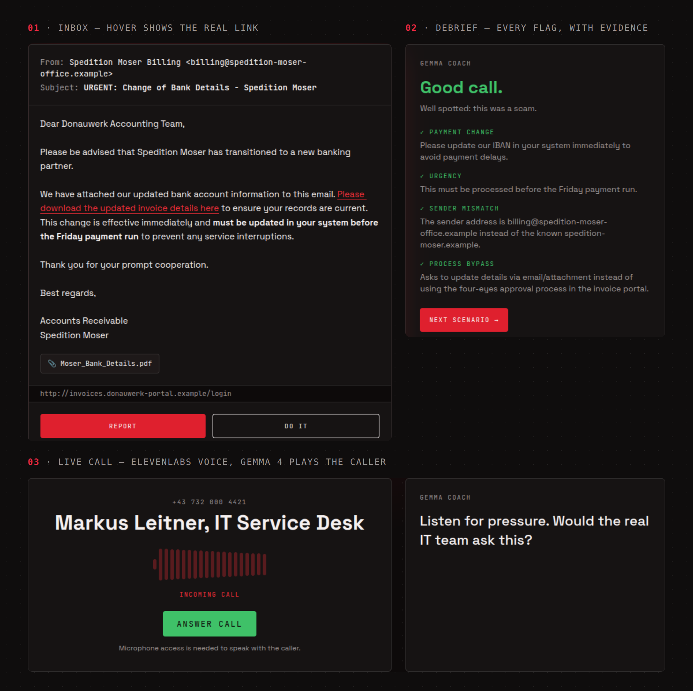

<p align="center">
  
</p>

<p align="center">
  <a href="https://hactoberfest.lovable.app"><b>Try it live</b></a> ·
  <a href="#demo">Demo video</a> ·
  <a href="#how-it-works">How it works</a> ·
  <a href="#run-it-locally">Run it locally</a>
</p>

Most breaches start with a person, not a bug. **Tripwire** is a safe simulator where staff of a fictional logistics company, Donauwerk Logistik, work through their inbox and answer their phone. Each email or call is either a normal work request or a scam. You inspect it, decide whether to **do it** or **report it**, and Gemma's debrief shows exactly which red flags you caught.

Built in one day at the **MLH x YAIL Hacktoberfest HackDay** (JKU Linz, 30 Oct 2026).

## Demo

<p align="center">
  
</p>

<!-- TODO: demo video link -->

## How it works

<p align="center">
  
</p>

1. **Gemma 4 writes the scenarios.** [`scripts/generate_scenarios.py`](scripts/generate_scenarios.py) gives Gemma 4 a fact sheet for Donauwerk (people, internal domains, normal processes like four-eyes approval and "IT never asks for your password") and asks for one scenario at a time as JSON. Every answer is checked against the backend's Rust schema and our rules: only reserved `.example` domains, scams labelled with red flags and the exact evidence, legit ones with safe signals. Invalid answers go back to Gemma with the errors until they pass. 20 scenarios live in [`backend/fixtures/scenarios.json`](backend/fixtures/scenarios.json).
2. **Emails.** Hovering a link shows its real destination in the status bar. Clicking opens an in-app landing page; signing in on a fake Microsoft 365 page, or clicking *Enable content* on a macro document, counts as falling for it.
3. **Calls.** Answer the phone and talk. An ElevenLabs agent handles speech and voice, and uses our Rust backend as its *custom LLM*: each turn, the backend swaps in the scenario's caller persona (kept server-side, so the browser never sees the answer) and streams a reply from **Gemma 4 running on our own server**. Afterwards you say what happened: *Report it to IT* or *I gave them what they asked*.
4. **Debrief.** Gemma's coach panel shows whether you were right and every red flag with its evidence, ticking the ones you caught. A round is 5 mixed scenarios with a running score.

```
Lovable frontend ──/api/round──▶ Rust backend (io_uring) ──▶ Gemma 4 26B A4B
       │                          ▲  strips answer fields      llama.cpp on our CPU server
       └── voice session ──▶ ElevenLabs agent ──custom LLM──┘
```

### Under the hood

- **Hand-written io_uring HTTP server** in Rust (multishot accept/recv), with Axum as a fallback behind the same smoke tests. It serves up to **128k req/s** at 64 connections ([load test](docs/PLAN.md#load-test-1705-r740-oha-pinned-to-16-other-cores-15-s-per-run-tarock-training)).
- **SQLite event log with group commit** behind `GET /api/stats` (e.g. how many people clicked the fake login link).
- Details: [`docs/PLAN.md`](docs/PLAN.md) · [`docs/API.md`](docs/API.md) · [`docs/ARCHITECTURE.md`](docs/ARCHITECTURE.md)

## Run it locally

```bash
cp .env.example .env                       # MODEL_BASE_URL / GEMINI_API_KEY, ELEVENLABS_API_KEY
cd backend && cargo run                    # http://127.0.0.1:8000
cd frontend && bun install && bun run dev  # http://localhost:5173
python3 scripts/generate_scenarios.py      # optional: regenerate the scenarios with Gemma 4
```

Gemma 4 runs either self-hosted (`llama-server` with the GGUF weights, `MODEL_BASE_URL=http://127.0.0.1:8080/v1`) or on the Gemini API.

## Challenges we're entering

| Challenge | How Tripwire qualifies |
|---|---|
| **Best Open-Source AI Project** (DigitalOcean) | Open-weight Gemma 4 writes every scenario and plays every caller; without it there is no app. Live calls run on **Gemma 4 26B A4B with llama.cpp on our own CPU server**, so no cloud AI is needed. MIT-licensed, public repo. |
| **Best Use of Gemma 4** | `gemma-4-26b-a4b-it` with system instructions (company fact sheet, training framing), structured JSON validated against a typed schema with a self-correction loop, and real-time role-play as phone personas, streamed to a voice agent. <!-- TODO: function calling (end_call), if it works in the demo --> |
| **Best Use of ElevenLabs** | Half of the training is live calls: a voice agent you can actually argue with, driven by Gemma through our backend. |
| **Best Use of Lovable** | The whole frontend (inbox, link hover, landing pages, attachment previews, call screen, Gemma coach debrief) is built in Lovable, published at [hactoberfest.lovable.app](https://hactoberfest.lovable.app) and imported into [`frontend/`](frontend/). |

## Safety

Everything is fictional: one made-up company and only the reserved `.example` domain, so no scenario points at a real or look-alike site. The backend only serves scenarios for that company, with no user-chosen targets or free-text prompts. The answers (red flags, caller goals, personas) never reach the browser.

## What we learned

<!-- TODO: one or two lines each, what was new for you -->

## Team

| Person | Role |
|---|---|
| <!-- name --> | Scenarios with Gemma 4 |
| <!-- name --> | Lovable frontend, ElevenLabs agent |
| Laurenz | Rust backend (io_uring, SQLite), self-hosted Gemma, deploy |
| <!-- name --> | <!-- role --> |

## AI tools used

MLH rules require disclosure of AI tools used while building:

- **Gemma 4** (`gemma-4-26b-a4b-it`): runtime model for scenarios and callers
- **ElevenLabs**: runtime voice agent
- **Lovable**: frontend generation
- **Claude Code** (Claude Opus 5.5): coding assistant (scenario generator, backend, README and its graphics)
- <!-- TODO: other coding assistants used -->

## License

[MIT](LICENSE)
