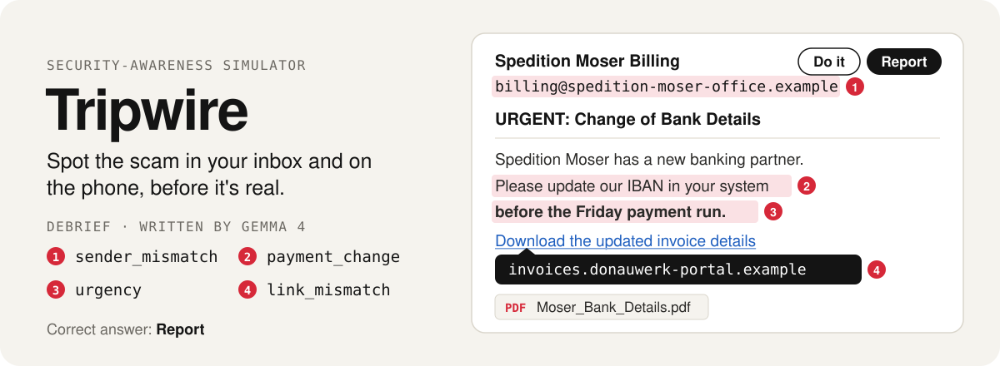
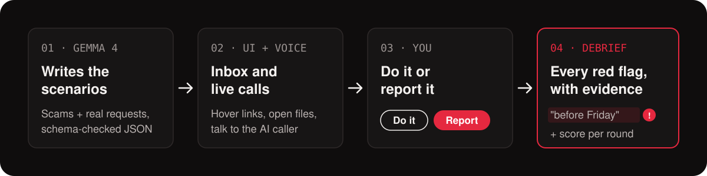

<p align="center">
  
</p>

<p align="center">
  <a href="https://hacktober.lpuehringer.dev"><b>Try it live</b></a> ·
  <a href="#demo">Demo video</a> ·
  <a href="#how-it-works">How it works</a> ·
  <a href="#run-it-locally">Run it locally</a>
</p>

Most breaches start with a person, not a bug. **Phishing Dojo** is a safe simulator where staff of a fictional company work through their inbox and answer their phone. Each email or call is either a normal work request or a scam. You decide whether to **do it** or **report it**, and the debrief shows exactly which red flags you caught or missed.

Built in one day at the **MLH x YAIL Hacktoberfest HackDay** (JKU Linz, 30 Oct 2026).

## Demo

<!-- TODO: video link + 2–3 screenshots (inbox with link hover, call screen, debrief) -->

The email above is real output: [`gen_email_03`](backend/fixtures/scenarios.json), written by Gemma 4 (text shortened to fit; the four red flags are the ones Gemma labelled).

## How it works

<p align="center">
  
</p>

1. **Gemma 4 writes the scenarios.** [`scripts/generate_scenarios.py`](scripts/generate_scenarios.py) gives Gemma 4 a fact sheet for the fictional *Donauwerk Logistik GmbH* (people, internal domains, normal processes like four-eyes approval and "IT never asks for your password") and asks for one scenario at a time as JSON. Every answer is checked against the backend's Rust schema and our rules: only reserved `.example` domains, scams labelled with red flags and the exact evidence, legit ones with safe signals. Invalid answers go back to Gemma with the errors until they pass.
2. **Emails** open in a fake inbox built with Lovable. Hovering a link shows where it really goes, links open in-app landing pages (fake Microsoft 365 login, intranet), and attachments open previews. Typing a password into a scam page or clicking *Enable content* counts as falling for it.
3. **Calls** are live voice conversations. An ElevenLabs agent uses our Rust backend as its *custom LLM*: each turn, the backend swaps in the scenario's persona (kept server-side, so the browser never sees the answer) and streams Gemma 4's reply back. Push back, ask to call back, or hang up and report.
4. **The debrief** shows each red flag with its evidence. A round is 5 mixed scenarios and ends with a score.

```
Lovable frontend ──/api/round──▶ Rust backend (Axum) ──▶ Gemma 4 (gemma-4-26b-a4b-it)
       │                          ▲  strips answer fields     Gemini API or local llama-server
       └── voice session ──▶ ElevenLabs agent ──custom LLM──┘
```

Details: [`docs/PLAN.md`](docs/PLAN.md) · [`docs/API.md`](docs/API.md) · [`docs/ARCHITECTURE.md`](docs/ARCHITECTURE.md)

## Run it locally

```bash
cp .env.example .env                       # GEMINI_API_KEY, ELEVENLABS_API_KEY
cd backend && cargo run                    # http://127.0.0.1:8000
python3 scripts/generate_scenarios.py      # optional: regenerate the scenarios with Gemma 4
```

For a self-hosted Gemma 4, run `llama-server` with the GGUF weights and set `MODEL_BASE_URL=http://127.0.0.1:8080/v1`. Frontend: [`frontend/README.md`](frontend/README.md).

## Challenges we're entering

| Challenge | How this project qualifies |
|---|---|
| **Best Open-Source AI Project** (DigitalOcean) | Open-weight Gemma 4 writes every scenario and plays every caller; without it there is no app. MIT-licensed, public repo. Gemma 4 26B A4B also runs on our own CPU server with llama.cpp (Q4_0, ~11.6 tokens/s, [benchmark](docs/PLAN.md#model-hosting)); switching is one env var. |
| **Best Use of Gemma 4** | `gemma-4-26b-a4b-it` with system instructions (company fact sheet, training framing), structured JSON validated against a typed schema with a self-correction loop, and real-time role-play as phone personas. <!-- TODO: function calling (end_call), if it works in the demo --> |
| **Best Use of ElevenLabs** | Half of the training is live calls: a voice agent you can actually argue with, driven by Gemma through our backend. |
| **Best Use of Lovable** | The whole frontend (inbox, link hover, landing pages, attachment previews, call screen, debrief) is built in Lovable: <!-- TODO: Lovable repo URL -->. Mirrored into [`frontend/`](frontend/). |

## Safety

Everything is fictional: one made-up company and only the reserved `.example` domain, so no scenario points at a real or look-alike site. The backend only serves scenarios for that company, with no user-chosen targets or free-text prompts. The answer fields (red flags, caller goals, personas) never reach the browser.

## What we learned

<!-- TODO: one or two lines each, what was new for you -->

## Team

| Person | Role |
|---|---|
| <!-- name --> | Scenarios with Gemma 4 |
| <!-- name --> | ElevenLabs voice agent |
| Laurenz | Rust backend, deploy, call relay |
| <!-- name --> | Lovable frontend & design |

## AI tools used

MLH rules require disclosure of AI tools used while building:

- **Gemma 4** (`gemma-4-26b-a4b-it`): runtime model for scenarios and callers
- **ElevenLabs**: runtime voice agent
- **Lovable**: frontend generation
- **Claude Code** (Claude Opus 5.5): coding assistant (scenario generator, README and its graphics, docs, backend)
- <!-- TODO: other coding assistants used -->

## License

[MIT](LICENSE)
