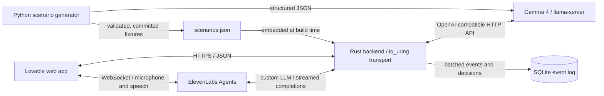

# Tripwire architecture

Tripwire is a security-awareness simulator for employees of the fictional
Donauwerk Logistik GmbH. A round combines phishing and legitimate emails with
live social-engineering calls. The trainee inspects the evidence, chooses an
action, and receives feedback against the scenario's stored labels.

This document describes the implemented system, not the kickoff plan. The Rust
source and the Lovable frontend can advance independently; differences are noted
below. Request and response shapes are documented in [API.md](API.md).

## System overview

The browser connects directly to ElevenLabs for voice sessions. The Rust backend
does **not** proxy microphone audio or synthesize speech: it supplies Gemma's
scenario-specific responses through the custom-LLM relay.

## Components and source layout

| Component | Responsibility | Source |
|---|---|---|
| Lovable frontend | Inbox, simulated links and attachments, live calls, decisions, debrief and local round score | `frontend/src/` is the repository snapshot; frontend development belongs in Lovable |
| Application setup | Shared state, routes, CORS and request tracing | `backend/src/lib.rs`, `backend/src/main.rs` |
| io_uring HTTP transport | Linux socket I/O, HTTP parsing, dispatch and streamed response writes | `backend/src/uring.rs` |
| Training API | Round selection, public scenarios, events, decisions and statistics | `backend/src/routes.rs` |
| Scenario schema | Typed scenario data and recursive removal of private answer fields | `backend/src/scenario.rs` |
| Custom-LLM relay | Private caller prompt, model selection, upstream requests and SSE streaming | `backend/src/relay.rs` |
| Round coaching API | Recomputed scores, weak spots and optional Gemma feedback | `backend/src/summary.rs` |
| Event storage | SQLite writer, group commit and aggregate queries | `backend/src/db.rs` |
| Offline content generation | Gemma scenario generation and validation | `scripts/generate_scenarios.py` |
| Scenario corpus | Generated scenarios plus hand-written reference fixtures | `backend/fixtures/scenarios.json` |

### Backend transport: io_uring

The custom HTTP/1.1 server is implemented, not a future replacement. Enable it
with `SERVER=uring`; `URING_WORKERS` controls the worker count (default: four).

- Each worker owns an io_uring instance and a `SO_REUSEPORT` listener.
- Multishot accept and receive operations use a registered provided-buffer ring.
- `httparse` parses incoming HTTP requests. Requests that complete immediately
  can run inline on the worker; pending work continues on the Tokio runtime.
- An output queue and `eventfd` return asynchronous response data to the worker.
  Responses support keep-alive and chunked output, including Gemma's SSE stream.
- The implementation accepts content-length request bodies up to 1 MiB and
  rejects transfer-encoded requests. It needs Linux with the required io_uring
  operations available; container security policies can block them.

**Transport versus application routing:** io_uring replaces the socket-serving
layer, not the shared application router. The current source still uses Axum
types, routing and handlers internally. `main.rs` also retains its conventional
listener when `SERVER` is not `uring`; `.env.example` still selects that fallback.
To run the custom transport, explicitly set `SERVER=uring`. This is not an
Axum-free codebase, even though io_uring is the transport highlighted here.

### Frontend

The app uses React, TypeScript, TanStack Start, Vite and Tailwind CSS. Its backend
URL is configured in `src/config.ts`. It does not need a browser-side Gemini or
ElevenLabs API key.

Frontend changes belong in the Lovable project, not this repository's
`frontend/` directory. Publishing Lovable and merging this repository are separate
operations. The repository snapshot can lag the preview or published app; do not
assume a GitHub merge publishes the frontend.

`scripts/sync-frontend.sh` provides a one-way subtree import/update workflow.
The existing snapshot was imported separately; confirm its history before using
the script against an already populated `frontend/` directory.

## Training data and request flow

### 1. Generate content before runtime

The Python generator requests structured scenario JSON from Gemma, validates the
result and retries corrections before fixtures are committed. The current corpus
contains 23 scenarios: 20 generated and three hand-written, split into 14 emails
and nine calls. Scenarios include both scams and legitimate requests.

The backend embeds the fixture file with `include_str!`. Changing it requires a
rebuild; starting a round does not generate new scenarios or call a model.

### 2. Start a round and inspect a scenario

`POST /api/round` selects five distinct scenarios, aiming for two or three scams
and including at least one call when available. It returns scenario references;
the browser fetches each through `GET /api/scenario/{id}`.

The public representation recursively removes answer fields such as `isScam`,
red flags, safe signals, the correct action, and private caller goals/personas.
Email links and attachments are simulated inside the app rather than opening
real phishing sites. Browser interactions can be recorded through
`POST /api/scenario/{id}/event`.

### 3. Run a live call

1. The frontend selects an ElevenLabs agent/voice and starts a WebSocket session
   with dynamic variables `scenario_id` and `opening_line`.
2. ElevenLabs speaks `{{opening_line}}`, transcribes microphone input and manages
   speech output and turn-taking.
3. Its custom-LLM request reaches `POST /v1/chat/completions`. The backend also
   accepts `/chat/completions` for compatible agent configurations.
4. The relay checks `RELAY_TOKEN` when configured, resolves the scenario, rejects
   non-call scenarios, and replaces incoming system messages with the private
   persona, goal and phone-conversation rules from the fixture.
5. It overrides the requested model with `GEMMA_MODEL`, preserves conversation and
   tool data, and forwards the request to `MODEL_BASE_URL/chat/completions`.
6. Gemma's response streams back to ElevenLabs without bespoke tool translation.
   ElevenLabs executes its configured `end_call` system tool when requested.

The tested ElevenLabs custom-LLM configuration uses the **base URL**
`https://hacktober-api.lpuehringer.dev/v1`; its runtime appends
`/chat/completions`. Do not append that suffix twice.

The latest Lovable implementation routes callers across six stock-voice agents:
Eric, George and Roger; Sarah, Alice and Jessica. Agent IDs and voice IDs are
public configuration, not credentials. The agents use `turn_v2`, protect the
opening message from interruption and disable closed-model LLM backup. The
microphone meter reads actual SDK input levels/frequency data. These changes are
newer than the repository frontend snapshot.

Ending a call is **not** a scoring decision. The interface keeps report/comply
explicit, and connection failures must not be counted as compliance. The relay
instructs Gemma to end after achieving its goal, completing a legitimate request
or receiving two clear refusals; model behaviour is not a reliable outcome label.

### 4. Score and debrief

`POST /api/scenario/{id}/decision` compares the chosen action with the stored
scenario label. Reporting is correct for a scam; a non-report action is correct
for a legitimate request. The model does not decide whether the trainee passed.

The response includes red flags, safe signals, caught/missed evidence and tips.
Optional client-observed events can distinguish noticing a suspicious link from
acting safely. The latest Lovable client sends these observations; the repository
snapshot's client does not yet do so.

`POST /api/round/summary` recomputes scores from submitted scenario actions,
identifies up to three weak spots and asks Gemma for a short coaching note. After
25 seconds or a model failure, it returns rule-based feedback instead.
**This endpoint and `GET /api/stats` are implemented in the backend but are not
called by the inspected frontend API client.** The UI's round score remains
client-side; do not describe backend coaching as an integrated screen yet.

## Model hosting

The documented deployment runs Gemma 4 26B A4B Q4_0 on CPU through
`llama-server`, managed as `hacktober-gemma`, with two parallel slots at
`http://127.0.0.1:8080/v1`. The model file is stored in `/dev/shm` and must be
restored after a reboot. See [PLAN.md](PLAN.md) for the operator runbook.

Set `MODEL_BASE_URL` explicitly for self-hosting. If unset, the Rust configuration
defaults to Gemini's OpenAI-compatible endpoint, with `GEMINI_API_KEY` supplying
the credential. This is an alternative host for **Gemma**, not a substitution
with a Gemini or OpenAI model. For non-Google upstreams, the backend sets
`chat_template_kwargs.enable_thinking=false` to avoid long spoken-turn delays.

## Persistence and state

`DB_PATH` selects the SQLite database (default: `hacktober.db`). A dedicated writer
uses WAL mode, `synchronous=NORMAL` and group commit: a batch is committed every
50 ms or at 256 events. Readers use a separate connection. Events include scenario
interactions and decisions; `/api/stats` aggregates them by scenario.

If the database cannot open, the backend logs the failure and continues without
persistent event storage; `/api/stats` then returns 503. Recorded events are not a
durable user/session system: round IDs use an in-process counter, and the summary
API accepts client-submitted results rather than a stored round history.

## Deployment and configuration

| Service | Address / operation |
|---|---|
| Published frontend | `https://hactoberfest.lovable.app` |
| Lovable preview | `https://id-preview--27704a8a-5cbe-462a-b04c-5e8a42825448.lovable.app` |
| Public Rust API | `https://hacktober-api.lpuehringer.dev`, exposed through a Cloudflare tunnel |
| Model server | `http://127.0.0.1:8080/v1`, reachable by the backend on the host |

The older `hacktober.lpuehringer.dev` frontend domain is not assumed to be live.
The documented backend deployment polls `main` every 30 seconds, builds the
release binary, restarts `hacktober-backend` and checks `/health`. A backend merge
can therefore affect the live demo; frontend publishing remains independent.

Key settings (see [`.env.example`](../.env.example)):

| Variables | Purpose |
|---|---|
| `SERVER=uring`, `URING_WORKERS` | Select the custom transport and worker count |
| `HOST`, `PORT` | Bind address; defaults to `127.0.0.1:8000` |
| `MODEL_BASE_URL`, `GEMMA_MODEL`, `GEMINI_API_KEY` | Model host, model ID and optional upstream credential |
| `RELAY_TOKEN` | Shared bearer secret between ElevenLabs and the custom-LLM relay |
| `DB_PATH` | SQLite database location |
| `CORS_ORIGINS` | Additional exact browser origins; HTTPS Lovable app/preview origins are already allowed |
| `ELEVENLABS_API_KEY`, `ELEVENLABS_VOICE_ID` | Agent provisioning/generation tooling; not needed in browser code |

The binary reads environment variables; it does not load `.env` itself. Production
secrets are configured separately on the host in `/etc/hacktober/backend.env`.
Ask the deployment owner to change host settings; do not run the named production
tunnel or modify competing server workloads from a development machine.

## Security boundaries and current limits

- Upstream credentials stay on the server or in ElevenLabs workspace secrets.
  The browser receives only public API URLs, agent IDs and scenario display data.
- Self-hosted Gemma keeps model inference on the team's server, **not all voice
  data**: ElevenLabs still processes microphone audio, transcripts and speech.
- Private scenario fields are excluded from the pre-decision scenario response,
  but debrief and statistics deliberately reveal labels. The API is a training
  demo, not a tamper-proof examination service.
- CORS is a browser-origin policy, not authentication. The public training API
  has no user authentication; public voice agents need quota/access controls to
  limit credit exposure. Keep `RELAY_TOKEN` configured for the relay.
- There is no backend transcript-based automatic outcome classifier. Explicit
  trainee decisions remain separate from model tool calls and transport errors.
